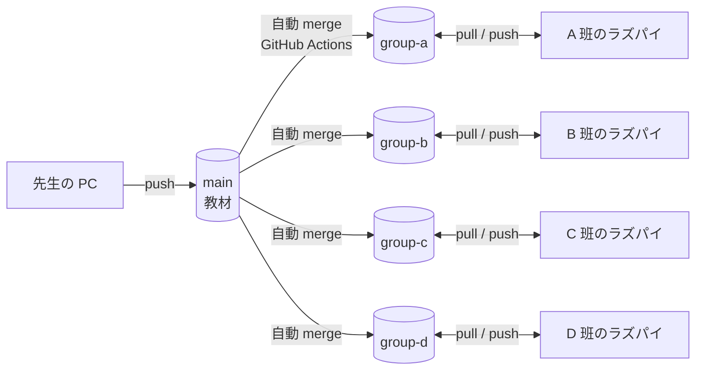

# ブランチの使い方と教材の配り方

## 全体の図



| ブランチ | 誰が書くか | 内容 |
|---|---|---|
| `main` | 先生だけ | 教材(`lesson02/`、`docs/`) |
| `group-a` 〜 `group-d` | その班の受講生(5 人それぞれのアカウントから) | `main` の内容 + 1 人ずつの作業(`students/ユーザー名/`) |

受講生は `main` に push できません(GitHub の ruleset で止まります)。間違えて `main` に切り替えて作業しても、push のときにエラーになるだけでデータは消えません。

## 毎回の流れ

```
cd ~/seminar2
git branch                    # * group-a のように自分の班か確認
git pull                      # 教材と仲間の変更を取り込む
# students/自分のユーザー名/ の下で編集・実行
git status                    # 何を変えたか確認
git add students/$USER/       # 自分のフォルダの変更だけを追加($USER は自分のユーザー名)
git commit -m "直進のテストを追加"
git pull                      # 仲間が先に push していたら取り込む
git push
```

班の 5 人が同じブランチに push します。仲間が先に push していると、`git push` が `rejected (fetch first)` で拒否されます。`git pull` してからもう一度 `git push` すれば通ります。各自が自分のフォルダだけを触っていれば衝突しません。

コミットメッセージは「何をしたか」を一言で。日本語でかまいません。

## 衝突したとき

同じファイルの同じ場所を 2 人が別々に直すと、`git pull` のときに `CONFLICT` と表示されます。自分のフォルダ以外を編集しなければ、ふつうは起きません。

1. `git status` で `both modified` のファイルを見る。
2. そのファイルを開くと、こういう印があります。

   ```
   <<<<<<< HEAD
   自分の変更
   =======
   相手の変更
   >>>>>>> origin/group-a
   ```

3. 残したい方を選んで、印の行(`<<<<<<<`、`=======`、`>>>>>>>`)を消す。両方残してもよい。
4. `git add そのファイル` → `git commit` → `git push`。

直せなくなったら、先生を呼んでください。`git merge --abort` で pull 前の状態に戻せます。

## やってはいけないこと

- `git push --force`(履歴を書き換える)。ruleset で拒否されますが、やらないでください。
- 他の班のブランチへの push。
- 先生の教材と問題(`lesson02/`、`lesson02/excersises/`)の編集(教材の更新と衝突します)。作業は `students/自分のユーザー名/` に置きます。
- 他の人のフォルダ(`students/他の人/`)の編集。

Git のコマンドそのものがはじめての人は [git-basics.md](git-basics.md) を先に読んでください。
