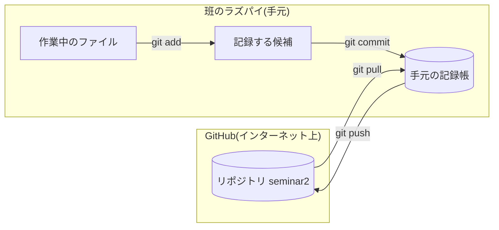

# Git と GitHub の基本(はじめての人向け)

この授業で必要な範囲だけをまとめています。全部を覚える必要はありません。困ったらこのページに戻ってきてください。

## 1. Git と GitHub は何が違う?

| | Git | GitHub |
|---|---|---|
| 何者か | 手元の PC やラズパイで動く「変更の記録帳」 | インターネット上の「記録帳の置き場」(Web サービス) |
| 何をする | いつ・誰が・何を変えたかを残す。前の状態に戻せる | 記録帳を班で共有する。ブラウザで中身を見られる |
| 例えると | ノートに日付入りで書き留める | そのノートを共有の本棚に置く |

Git で記録して、GitHub に送ると班の仲間と共有できます。

## 2. 用語



| 用語 | 意味 |
|---|---|
| **リポジトリ** | ファイル一式と、その変更の記録をまとめたもの。この授業では `seminar2` |
| **コミット** | 「ここまでの変更を 1 つの記録として残す」操作。メッセージ(何をしたか)を付ける |
| **ブランチ** | 記録の流れを分けたもの。この授業では `main`(教材)と `group-a` 〜 `group-d`(班ごと) |
| **リモート / origin** | インターネット上のリポジトリのこと。`origin` はその呼び名 |
| **clone** | GitHub からリポジトリを手元に丸ごとコピーする(最初の 1 回だけ) |
| **pull** | GitHub の新しい記録を手元に取り込む |
| **push** | 手元の記録を GitHub に送る |

## 3. 変更が記録されるまでの 3 段階

1. **ファイルを編集する**(まだ Git は何も記録していない)
2. **`git add`** で「これを記録する」と選ぶ
3. **`git commit -m "メッセージ"`** で記録する(手元だけ)
4. **`git push`** で GitHub に送る(ここで班の仲間に見えるようになる)

```
編集 ──add──> 候補 ──commit──> 手元の記録 ──push──> GitHub
```

「add したのに push していない」と仲間には見えません。「commit したのに add していない」と何も記録されません。順番が大事です。

## 4. この授業で使うコマンド

| コマンド | いつ使う | 画面に出るもの |
|---|---|---|
| `git branch` | 今どのブランチにいるか確かめる(作業の最初) | `* group-a` のように `*` が今の場所 |
| `git status` | 何を変えたか、add 済みか確かめる(迷ったらまずこれ) | 赤 = まだ add していない、緑 = add 済み |
| `git pull` | 作業の最初に、教材や仲間の変更を取り込む | 取り込んだファイル名 |
| `git add students/$USER/` | 自分のフォルダの変更を記録する候補にする(`$USER` は自分のユーザー名) | 何も出ない(成功) |
| `git commit -m "メッセージ"` | 記録する | `1 file changed, 10 insertions(+)` など |
| `git push` | GitHub に送る | `group-a -> group-a` など |
| `git log --oneline -5` | 最近の記録 5 件を見る | 番号とメッセージの一覧 |
| `git diff` | 編集した中身を見る(add する前) | `+` が追加した行、`-` が消した行 |

毎回の流れは次の 7 行だけです。

```
cd ~/seminar2
git branch
git pull
git add students/$USER/
git commit -m "直進のテストを追加"
git pull
git push
```

push の直前にもう一度 `git pull` するのは、班の仲間が先に push していることがあるからです。

## 5. GitHub の画面の見方

https://github.com/ishikuro-lab/seminar2 を開くと:

- 左上の **ブランチ名のボタン**(最初は `main`)を押すと、`group-a` などに切り替えられます。自分の班のブランチに切り替えて、push した内容が届いているか確かめられます。
- ファイル名を押すと中身が見えます。右上の **History** でそのファイルの変更の記録が見られます。
- ファイル一覧の上にある **「N commits」** を押すと、記録の一覧(誰が・いつ・何を)が見られます。

## 6. よく出るメッセージと意味

| メッセージ | 意味 | どうする |
|---|---|---|
| `nothing to commit, working tree clean` | 変更がない(記録済み) | 何もしなくてよい |
| `Changes not staged for commit` | 編集したが add していない | `git add students/$USER/` |
| `rejected ... (fetch first)` | 仲間が先に push した | `git pull` してからもう一度 `git push` |
| `Your branch is behind 'origin/group-a'` | 仲間が先に push した | `git pull` |
| `Your branch is ahead of 'origin/group-a' by 1 commit` | commit したが push していない | `git push` |
| `CONFLICT (content): Merge conflict in ...` | 同じ場所を別々に直した | [branch-workflow.md](branch-workflow.md) の「衝突したとき」 |
| `GH013: Repository rule violations` | `main` に push しようとした | `git branch` で確認し、`git checkout group-a`(自分の班) |
| `Please tell me who you are` | 名前の設定がない | `git config --global user.name "名前"` と `user.email` を設定 |
| `Permission denied` / `could not read Username` | GitHub の認証が切れた | `gh auth login`([raspi-setup.md](raspi-setup.md)) |

## 7. 困ったときの基本

1. `git status` を読む。何が起きているかはだいたいここに書いてあります。
2. `git log --oneline -5` で、最近の記録を見る。
3. 間違えて編集したファイルを元に戻す: `git checkout -- ファイル名`(まだ add していないとき)。
4. それでも分からなければ、画面のメッセージをそのまま先生に見せてください。消えたように見えても、commit 済みの記録は残っています。

## 8. 用語の読み方

| 書き方 | 読み方 |
|---|---|
| Git | ギット |
| GitHub | ギットハブ |
| repository | リポジトリ |
| commit | コミット |
| branch | ブランチ |
| pull / push | プル / プッシュ |
| merge | マージ(取り込む・合わせる) |
| conflict | コンフリクト(衝突) |
