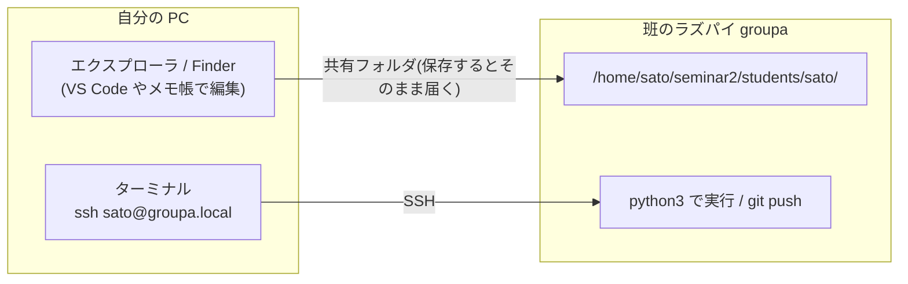

# ラズパイの使い方

班ごとに Raspberry Pi Zero 2 W が 1 台あります。ラズパイには **1 人 1 つのアカウント** があります。

- ユーザー名: 自分の姓のローマ字(例: 佐藤 → `sato`、伊藤 → `ito`)。班に同じ姓の人がいるときは先生が決めます(例: `sato-k`)。
- パスワード: 班で共通です。授業で伝えます。`passwd` で変えないでください(共有フォルダのパスワードと食い違い、班の仲間も入れなくなります)。
- 自分のアカウントには、自分専用の `~/seminar2`(班のブランチ)が用意されています。他の人のファイルは見えません。

以下、`groupa` は自分の班に、`sato` は自分のユーザー名に読み替えてください。

## 1. ラズパイにつなぐ(SSH)

同じ Wi-Fi につないだ PC から:

```
ssh sato@groupa.local        # 自分のユーザー名と班の名前(groupa〜groupd)
```

`.local` で見つからないときは、ラズパイの画面か先生に IP アドレスを聞いて `ssh sato@192.168.x.x` とします。入れたら `whoami` で自分のユーザー名が出ることを確かめます。

## 2. GitHub に自分のアカウントで認証する(初回だけ)

ラズパイには `gh`(GitHub CLI)が入っています。

```
gh auth login
```

質問には次のように答えます。

| 質問 | 答え |
|---|---|
| Where do you use GitHub? | GitHub.com |
| Preferred protocol | HTTPS |
| Authenticate Git with your GitHub credentials? | Yes |
| How would you like to authenticate? | Login with a web browser |

表示される 8 文字のコードをメモして、スマホか PC で https://github.com/login/device を開き、コードを入力して承認します。終わったら:

```
gh auth setup-git
git config --global user.name  "自分の名前(ローマ字可)"
git config --global user.email "GitHub に登録したメールアドレス"
```

これで `git push` が自分の名前で記録されます。自分のアカウントでやれば、班の仲間とは別々に記録されます。

## 3. リポジトリと自分のフォルダ

```
cd ~/seminar2
git branch        # * group-a のように自分の班が表示されればOK
git pull
```

初回クローンは先生が済ませてあります。もし `~/seminar2` が無ければ:

```
git clone -b group-a https://github.com/ishikuro-lab/seminar2.git ~/seminar2
```

(`group-a` は自分の班に読み替え)

`~/seminar2` の中で、自分が書いてよいのは **`students/自分のユーザー名/` だけ** です。

| 場所 | 中身 | 編集 |
|---|---|---|
| `lesson02/` | 先生の教材 | しない |
| `lesson02/excersises/` | 先生の練習問題 | しない(自分のフォルダにコピーして解く) |
| `students/sato/` | 自分の作業場所 | する |
| `students/ito/` など | 班の仲間の作業(`git pull` で届く) | しない(読むだけ) |

## 4. 第2回の教材を動かす

練習問題を自分のフォルダにコピーしてから解きます。`$USER` は自分のユーザー名に自動で置き換わるので、全員同じコマンドで大丈夫です。

```bash
cd ~/seminar2
git pull
mkdir -p students/$USER/lesson02
cp -n lesson02/excersises/*.py students/$USER/lesson02/
cd students/$USER/lesson02
python3 01_led_five_seconds.py
```

`cp -n` は、すでにあるファイルを上書きしません。2 回目に打っても自分の答えは消えません。各コードのコメントを読み、コメントの下に自分でコードを書き、保存してから実行します。

LED は GPIO12 → 抵抗330 Ω → LED → GND に接続します。先に [第2回の配線と説明](../lesson02/README.md) を確認してください。

## 5. ファイルの編集(PC から共有フォルダを開く)

自分の `~/seminar2` は、PC から **共有フォルダ** として開けます。USB メモリを開くのと同じ操作で、保存した瞬間にラズパイのファイルが変わります。PC に何も入れなくてよいので、この方法をおすすめします。実行と git は SSH の画面で行います。



### 開き方(初回だけパスワードを入れる)

| | Windows | Mac |
|---|---|---|
| 1 | エクスプローラのアドレス欄に `\\groupa.local\sato` と打って Enter | Finder → 移動 → サーバへ接続(⌘K)→ `smb://groupa.local/sato` → 接続 |
| 2 | ユーザー名は自分のユーザー名(`sato`)、パスワードは班で共通のもの。「資格情報を記憶する」にチェック | 「登録ユーザ」で名前は自分のユーザー名、パスワードは班で共通のもの。「キーチェーンに保存」にチェック |
| 3 | `students\sato` フォルダの中を編集する | `students/sato` フォルダの中を編集する(`/Volumes/sato` として見えます) |

共有フォルダの名前は自分のユーザー名です。他の人の名前では開けません。`.local` の名前で開けないときは、ラズパイで `hostname -I` を見て `\\192.168.2.xx\sato`(Mac は `smb://192.168.2.xx/sato`)。

### VS Code で 1 画面にする(おすすめ)

VS Code は拡張機能なしで共有フォルダを開けます。上でコードを直し、下のターミナルで実行、が同じ画面に並びます。

1. 上の「開き方」で一度共有フォルダを開いておく(パスワードを覚えさせる)。
2. VS Code → ファイル → フォルダーを開く → Windows はアドレス欄に `\\groupa.local\sato`、Mac は `/Volumes/sato` → 開く。
3. ターミナル → 新しいターミナル → `ssh sato@groupa.local` → パスワード → `cd seminar2/students/$USER/lesson02`。
4. 左で `students/sato/lesson02/` のファイルを直して保存(Ctrl+S / ⌘S)→ 下のターミナルで `python3 01_led_five_seconds.py`。止めるのは `Ctrl+C`。
5. 区切りで、同じターミナルから `cd ~/seminar2` → `git add students/$USER/` → `git commit -m "何をしたか"` → `git pull` → `git push`。

2 回目からは、VS Code を開く → ターミナルで `ssh ...` を打つ → 編集と実行、の 3 手です。Mac は先に Finder の ⌘K で接続し直してから VS Code を開きます(接続が外れているとフォルダが空に見えます)。

### 班で使うときのルール

ファイルは 1 人ずつ別なので、保存で他の人の変更を消すことはありません。ラズパイの部品(LED、センサ、モーター)は班で 1 組なので、次を守ります。

- **実行は声をかけて 1 人ずつ。** 2 人同時に動かすと `GPIO busy` になります。
- 自分のプログラムは自分で止める(`Ctrl+C`)。他の人のプログラムは止められません。
- 班の仲間のコードは `git pull` すると `students/仲間の名前/` に届きます。読むだけにします。
- 第 3 回の班共通のプログラムは、代表 1 人が自分のフォルダに置きます。他の人は `git pull` で読みます。

### 共有フォルダが開けないとき

- 30 秒待ってもう一度(ラズパイの Wi-Fi が一時的に切れていることがあります)。
- だめなら IP で開く(上の「開き方」)。
- それでもだめなら、github.com で直接編集できます。ブラウザで `ishikuro-lab/seminar2` を開き、ブランチを自分の班(`group-a` など)に切り替え → `students/自分のユーザー名/` のファイルを開いて鉛筆アイコン → 編集 → 「Commit changes」。そのあとラズパイの SSH で `git pull` すると届きます。直すたびに commit と pull が要るので、試行錯誤には向きません。

### そのほかの方法

- ラズパイの画面しか無いとき: `nano ~/seminar2/students/$USER/lesson02/01_led_five_seconds.py`(保存は `Ctrl+O`、終了は `Ctrl+X`)。
- VS Code の Remote-SSH 拡張に慣れている人: 使えますが、ラズパイのメモリの都合で **班で同時に使えるのは 1 人** です。他の人が共有フォルダで作業していても問題ありません。

## トラブル対処

くわしくは [troubleshooting.md](troubleshooting.md)(症状から引ける一覧)。よくあるものだけ:

| 症状 | 対処 |
|---|---|
| `ssh` がつながらない | 30 秒待ってもう一度。だめならラズパイの画面で `ping -c 3 192.168.2.1` → `nmcli device disconnect wlan0 && nmcli device connect wlan0` |
| `Name or service not known` | ラズパイで `hostname -I` を見て `ssh sato@192.168.x.x` |
| `Permission denied (password)` | ユーザー名が違うか、パスワードが違う。ユーザー名は姓のローマ字、パスワードは班で共通 |
| `GPIO busy` と出る | 誰かのプログラムが動いています。`ps -o user,pid,cmd -C python3` で誰のものか見る。自分のものなら `kill <番号>`、他の人のものなら本人に `Ctrl+C` を頼む |
| `git push` が `rejected (fetch first)` | 班の仲間が先に push しています。`git pull` してからもう一度 `git push` |
| `git push` が `GH013` で拒否 | `main` に push しようとしています。`git branch` で確認し、`git checkout group-a` に戻る |
| `sudo` が必要と言われた | 受講生は使えません。先生を呼んでください |
